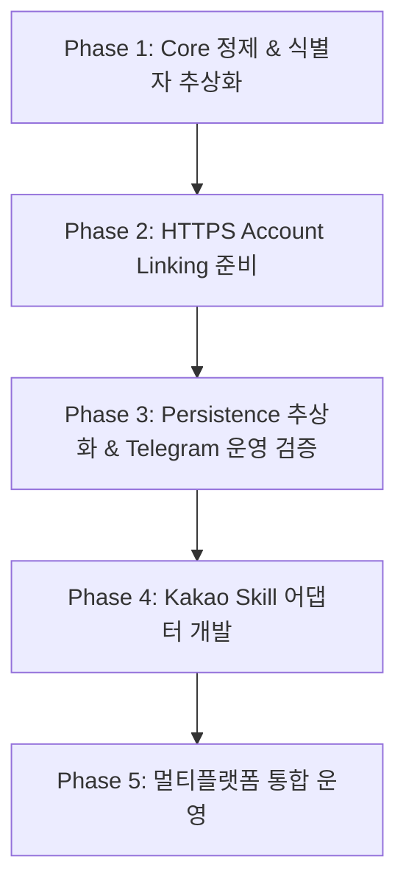

# SureMeetingRoom Bot v0.2 운영 및 멀티플랫폼 구조 설계서

**문서 상태**: Approved (v0.2 Architecture Decision Baseline)  
**기준 버전**: `v0.1-local-mvp` (Commit: `f214e39`)  
**작성일**: 2026-10-15  
**목적**: Local MVP(`v0.1`) 안정화 이후, Production HTTPS 운영 환경과 멀티플랫폼(Telegram + Kakao) 확장을 위한 구조적 청사진 및 마이그레이션 전략 정의

---

## 목차
1. [Current v0.1 Architecture](#1-current-v01-architecture)
2. [Problems & Limitations](#2-problems--limitations)
3. [v0.2 Goals & Principles](#3-v02-goals--principles)
4. [Platform Abstraction & Module Structure](#4-platform-abstraction--module-structure)
5. [User Identity Design](#5-user-identity-design)
6. [Production Account Linking](#6-production-account-linking)
7. [Persistence Requirements](#7-persistence-requirements)
8. [Hosting Requirements](#8-hosting-requirements)
9. [Security Considerations](#9-security-considerations)
10. [Kakao Expansion Strategy](#10-kakao-expansion-strategy)
11. [Recommended Implementation Order](#11-recommended-implementation-order)

---

## 1. Current v0.1 Architecture

v0.1-local-mvp는 로컬 단일 인스턴스 환경에서 Telegram Bot 및 Groupware API 연동과 사용자별 데이터 격리를 검증한 안정 버전입니다.

```text
+-----------------------------------------------------------------------------------+
|                            Telegram Messenger Client                              |
+-----------------------------------------------------------------------------------+
                                         │ Long Polling (Update)
                                         ▼
+-----------------------------------------------------------------------------------+
|                        Telegram Interface Layer (`telegram/`)                     |
|  - bot.py: ApplicationBuilder, Provider Dependency Injection                      |
|  - handlers.py: Telegram Update/Callback Query Event Loop & Text Rendering        |
|  - keyboards.py: InlineKeyboardButton / InlineKeyboardMarkup Builders            |
|  - states.py: UserStateManager (Per-user interactive menu state in memory)       |
+-----------------------------------------------------------------------------------+
                                         │
                                         │ user_id: str ("8296531540")
                                         ▼
+-----------------------------------------------------------------------------------+
|                      Query Provider Layer (`providers/`)                          |
|  ├─ RealMeetingRoomProvider: Live Groupware API proxy                             |
|  └─ MockMeetingRoomProvider: In-memory mock scenario provider                     |
+-----------------------------------------------------------------------------------+
                 │                                                   │
                 │ user_id: str                                      │ user_id: str
                 ▼                                                   ▼
+------------------------------------+             +--------------------------------+
|  UserSessionManager (`auth/`)      |             |  FavoriteService (`favorites/`)|
|  - _sessions: Dict[str, Client]    |             |  - JsonFavoriteRepository      |
|  - In-memory `requests.Session`    |             |  - `data/favorites.json`       |
+------------------------------------+             +--------------------------------+
                 │                                                   │
                 ▼                                                   │
+---------------------------------------------------+                │
|  Core Domain Services (`services/`)               |                │
|  - MeetingRoomService: High-level orchestration   |                │
|  - RoomStatusService: AVAILABLE/OCCUPIED logic    |                │
|  - AvailabilityService: Slot interval validation  |◄───────────────┘
+---------------------------------------------------+
                 │
                 ▼
+---------------------------------------------------+
|  GroupwareClient (`groupware/`)                   |
|  - requests.Session (GW Cookie, User-Agent)       |
|  - REST endpoints: /api/login, /api/asset, ...    |
+---------------------------------------------------+
```

### 1.1 계층별 구현 현황
1. **Telegram 레이어 (`src/meeting_room_bot/telegram/`)**:
   - `bot.py`: 텔레그램 `ApplicationBuilder` 설정, 환경변수(`TELEGRAM_DATA_MODE`) 기반 Mock/Real Provider 주입.
   - `handlers.py`: 텔레그램 비동기 이벤트 핸들러, 메시지 텍스트 렌더링, 인라인 키보드 교체(`safe_edit_message_text`).
   - `keyboards.py`: 텔레그램 전용 `InlineKeyboardButton` 규격에 맞춘 4개 탭/시간/층/즐겨찾기 키보드 빌더.
   - `states.py`: 사용자의 대화 탐색 위치(`last_menu`, `date`, `time`, `scope`, `asset_id` 등)를 보관하는 인메모리 `UserStateManager`.
   - `mock_service.py`: `providers/mock_data.py`의 목 데이터를 텔레그램 패키지에서 하위 호환 re-export.
2. **Account Linking 레이어 (`src/meeting_room_bot/account_link/`)**:
   - `app.py`: FastAPI 기반 웹 서버 (`GET/POST /link/{token}`).
   - `token_service.py`: 1회성 토큰 발급/검증/소각 인메모리 서비스 (`default_ttl=600s`).
   - `templates/`: 순수 HTML/CSS 폼 (`login.html`, `success.html`, `error.html`).
3. **Core Services & Models (`src/meeting_room_bot/{services, models, favorites, auth}/`)**:
   - `models/`: `Asset`, `Room`, `Reservation`, `UserFavorites`, `UserSessionInfo`, `UserKey` 등 도메인 모델.
   - `services/`: `MeetingRoomService`, `RoomStatusService`, `AvailabilityService` (Asia/Seoul 기준 완벽 격리).
   - `auth/session_manager.py`: `UserSessionManager`를 통한 사용자별 격리 `requests.Session` 보관.
   - `favorites/`: `JsonFavoriteRepository`를 통한 JSON 파일 기반 즐겨찾기 저장.

---

## 2. Problems & Limitations

v0.1-local-mvp는 로컬 단독 테스트 목적을 충족하지만, Production 배포 및 멀티플랫폼 확장 시 다음과 같은 구조적 한계가 존재합니다.

### 2.1 Telegram 플랫폼 강결합 (Coupling)
1. **`user_id` 식별자의 단일 네임스페이스 종속**:
   - `UserSessionManager`, `FavoriteService`, `AccountLinkTokenService` 등 시스템 전반에서 `user_id: str`을 직접 사용하며, 이는 텔레그램의 숫자형 `user.id`(`8296531540`)를 그대로 전제합니다.
   - 향후 카카오톡 봇 사용자 ID(문자열 해시값 형태)가 유입될 경우 네임스페이스 구분이 없어 충돌 위험이 있고, 동일 사용자가 텔레그램과 카카오톡을 모두 사용할 때 연결할 방법이 없습니다.
2. **메시지 표현 방식의 차이와 플랫폼별 렌더러 분리 필요성**:
   - Telegram(인라인 키보드, 마크다운 텍스트 편집)과 Kakao(고정 카드 템플릿, 5초 타임아웃 웹훅)는 사용자에게 보여주는 표현 형태가 근본적으로 다릅니다.
   - 따라서 공통 텍스트 조립을 Core에 강제하는 대신, **"Core는 구조화된 결과 데이터(Structured Result Data)를 반환하고, 표현은 각 메신저의 Platform Renderer가 담당"**하는 구조가 필수적입니다.
3. **Core 레이어의 Telegram 패키지 역참조 (v0.1 이슈 -> v0.2 해소)**:
   - v0.1에서는 `providers/mock_provider.py`가 `telegram/mock_service.py`를 역참조하던 위반이 존재했으나, v0.2 Phase 1에서 `providers/mock_data.py`로 분리하여 Core의 무종속성을 확립합니다.

### 2.2 Account Linking의 Localhost 제약
1. **Telegram URL 버튼 불가**:
   - Telegram 정책상 `http://localhost:8000` 형태의 로컬 HTTP URL은 `InlineKeyboardButton(url=...)`으로 설정할 수 없어 `BadRequest` 예외가 발생합니다.
   - 현재 v0.1은 이를 우회하기 위해 터미널 로그에 링크를 출력하고 안내 텍스트를 띄우는 수동 방식으로 동작 중입니다.
2. **Public HTTPS 부재**:
   - 운영 환경에서는 모바일 텔레그램/카카오톡 앱 내 인앱 브라우저에서 안전하게 원터치로 열릴 수 있는 공인 HTTPS 도메인 엔드포인트가 필수적입니다.

### 2.3 영속화(Persistence) 및 동시성 한계
1. **프로세스 재시작 시 세션 완전 유실**:
   - `UserSessionManager`가 메모리 딕셔너리로 동작하므로, 봇 서버 재배포나 재시작 시 모든 사용자의 그룹웨어 로그인 세션이 즉시 초기화되어 전원 재로그인이 요구됩니다.
2. **JSON 파일 기반 즐겨찾기의 동시성 위험**:
   - `JsonFavoriteRepository`는 `data/favorites.json` 파일 전체를 읽고 쓰는 구조입니다.
   - 다중 프로세스 또는 비동기 환경에서 동시 쓰기(Write Conflict) 발생 시 데이터 손실(Race condition)이 발생할 수 있습니다.
3. **상태(State) 메모리 관리**:
   - `UserStateManager`와 `AccountLinkTokenService` 모두 단일 프로세스 인메모리 구조로, 다중 서버 인스턴스(로드 밸런싱) 환경을 지원하지 못합니다.

---

## 3. v0.2 Goals & Principles

v0.2는 다음 6대 원칙을 기반으로 운영 안정성과 멀티플랫폼 확장성을 확보합니다.

1. **Clean Architecture (계층 분리)**:
   - UI 플랫폼(Telegram, Kakao)은 단순한 입출력 어댑터로 동작하며, 비즈니스 규칙과 데이터 조회는 100% Shared Core가 담당합니다.
2. **Platform-Agnostic User Identity (플랫폼 독립 사용자 식별)**:
   - 플랫폼 종류와 플랫폼 고유 ID를 묶은 `UserKey` 복합 식별자를 시스템 전반의 표준으로 사용합니다.
3. **Production-Grade HTTPS Account Linking**:
   - 유효한 SSL/TLS 인증서가 적용된 공인 HTTPS 도메인을 통해 모바일 메신저 원터치 웹 로그인을 제공합니다.
4. **Enterprise Security First (사내 보안 최우선)**:
   - 사내 그룹웨어 비밀번호는 절대 디스크나 DB에 영구 저장하지 않으며, 일회성 메모리 로그인 후 즉시 소각합니다.
   - SSO/OAuth2 연동 가능 여부를 우선 검토합니다.
5. **Selective & Pluggable Persistence (선택적/교체 가능한 영속화)**:
   - 특정 DB(Redis, PostgreSQL 등) 기술에 코드를 종속시키지 않고, Repository/Store 인터페이스를 두어 인프라 상황에 맞게 교체 가능하도록 설계합니다.
   - 세션 쿠키 영속화는 보안과 편의성 정책에 따라 선택 사항(Optional)으로 취급합니다.
6. **Zero Regression (무중단 및 안정성)**:
   - 기존 v0.1의 157개 회귀 테스트와 Telegram 실사용 기능을 완전히 보존하면서 점진적으로 리팩터링합니다.

---

## 4. Platform Abstraction & Module Structure

### 4.1 현재 코드 종속성 분류 및 아키텍처 원칙

| 구분 | 모듈 / 클래스 | Telegram 종속 여부 | 조치 방안 |
|---|---|---|---|
| **Platform Specific** | `telegram/bot.py`, `handlers.py`, `keyboards.py`, `states.py` | 100% Telegram 전용 | `telegram/` 계층에 유지 (TelegramRenderer 역할 수행) |
| **Platform Specific (Future)** | `kakao/skill_app.py`, `payload.py`, `responses.py` | 100% Kakao 전용 | Telegram 운영 검증 후 `platforms/kakao/`로 개발 |
| **Shared Core** | `groupware/client.py` | 완전 독립 | 유지 |
| **Shared Core** | `services/meeting_room_service.py`, `room_status_service.py`, `availability_service.py` | 완전 독립 | 유지 |
| **Shared Core** | `models/asset.py`, `reservation.py`, `room.py`, `user_key.py` | 완전 독립 | 유지 |
| **Shared Core** | `providers/base.py`, `real_provider.py`, `mock_data.py` | 완전 독립 | 유지 (Mock 분리 완료) |
| **Transition Compatibility Layer** | `auth/session_manager.py`, `favorites/service.py`, `token_service.py` | `Union[UserKey, str]` 지원 | 하위 호환성 유지 (v0.1 호환용 한시적 계층, 신규 어댑터는 UserKey 필수) |

### 4.2 Shared Structured Result + Platform Renderer 패턴

Core에 무리하게 메시지 텍스트 렌더러를 공통화하지 않습니다. Telegram과 Kakao는 표현 체계가 완전히 다르기 때문입니다.

- **Shared Core의 역할**:
  - `QueryResult(status=..., data={...})`를 통해 **완전한 구조화 데이터(Structured View Data)**를 반환합니다.
  - 데이터 내용: 회의실 이름, 가용 여부, 현재/다음 예약 시간, 수용 인원, 스케줄 슬롯, 위치명 등 순수 정보.
- **Platform Renderer의 역할**:
  - **Telegram Layer**: 구조화 데이터를 바탕으로 텔레그램 이모지(`🟢`, `🔴`), 줄바꿈, 텍스트 메시지, `InlineKeyboardMarkup`을 조합하여 전송/수정(`editMessageText`).
  - **Kakao Layer (Future)**: 구조화 데이터를 바탕으로 카카오 i 오픈빌더 전용 규격인 `BasicCard`, `Carousel`, `SimpleText`, `QuickReplies` JSON 객체를 생성하여 응답.

### 4.3 Legacy Compatibility 원칙 및 경계

현재 여러 Core 인터페이스(`UserSessionManager`, `FavoriteRepository`, `FavoriteService`, `AccountLinkTokenService`, `MeetingRoomQueryProvider`)가 `Union[UserKey, str]`을 수용하고 있습니다.

- **전환기 호환성 계층 (Transition Compatibility Layer)**:
  - 이는 v0.2 전환기 동안 v0.1 기반 테스트와 기존 저장 데이터 호환을 위해 제공되는 과도기적 인터페이스이며, 최종 영구 API가 아닙니다.
- **데이터 흐름 원칙**:
  - **Platform Adapter**: 플랫폼 인입부에서 즉시 명시적 `UserKey` 생성
    - Telegram: `UserKey("telegram", update.effective_user.id)`
    - Kakao: `UserKey("kakao", user_id)`
  - **Core 내부**: 100% `UserKey`를 표준 식별자로 사용
- **신규 플랫폼 규제**:
  - 신규 플랫폼 어댑터(Kakao 등)가 plain `str`을 Core에 넘겨서 `default_platform="telegram"`으로 오인되는 것을 방지합니다.
  - 신규 플랫폼 코드는 반드시 플랫폼명이 명시된 `UserKey` 객체를 생성하여 전달해야 합니다.

---

## 5. User Identity Design

### 5.1 문제 정의
기존 시스템은 텔레그램의 `update.effective_user.id` 정수값을 `str(user_id)`로 캐스팅하여 세션과 즐겨찾기 키로 사용했습니다.
- 카카오톡 사용자의 ID가 유입될 경우 식별자 공간 충돌 가능
- 동일한 임직원이 텔레그램과 카카오톡을 모두 사용할 때 계정 연동 및 즐겨찾기 공유 불가

### 5.2 `UserKey` 복합 식별자 구조 (순수 Channel Identity)
`UserKey`는 플랫폼상의 채널 사용자 식별자(`platform`, `platform_user_id`)만 순수하게 표현합니다.

```python
from dataclasses import dataclass
from typing import Union

@dataclass(frozen=True)
class UserKey:
    """Platform-independent channel identity identifying a user within a messaging platform.

    Architectural Principle:
    - UserKey represents ONLY the platform-specific channel identity (e.g. telegram:8296531540, kakao:k_12345).
    - It must NOT contain internal employee or corporate application user state (e.g. internal_user_id, emp_id),
      so that hash and equality remain strictly stable when used as dictionary/cache keys.
    - Future corporate user account mapping should be implemented as an independent mapping layer
      (e.g. AppUser / ChannelMapping) that links one or more UserKey instances to a single internal user.
    """
    platform: str          # "telegram" | "kakao"
    platform_user_id: str  # "8296531540" | "k_user_hash_1234"

    def to_string(self) -> str:
        return f"{self.platform}:{self.platform_user_id}"

    def __str__(self) -> str:
        return self.to_string()

    @classmethod
    def from_string(cls, raw: str, default_platform: str = "telegram") -> "UserKey":
        raw_str = str(raw).strip()
        if ":" in raw_str:
            parts = raw_str.split(":", 1)
            return cls(platform=parts[0].lower(), platform_user_id=parts[1])
        return cls(platform=default_platform, platform_user_id=raw_str)

    @classmethod
    def from_any(cls, val: Union["UserKey", str, int], default_platform: str = "telegram") -> "UserKey":
        if isinstance(val, UserKey):
            return val
        return cls.from_string(str(val), default_platform=default_platform)
```

#### `internal_user_id`를 `UserKey`에서 배제한 이유
1. **Hash / Equality 정합성 보장**:
   - `UserKey`는 세션 딕셔너리(`_sessions[user_key]`), 즐겨찾기 캐시 등의 키(Dict Key)로 직접 활용됩니다.
   - 만약 `UserKey` 내부에 `internal_user_id` 필드가 존재한다면, 동일한 텔레그램 사용자라도 연동 전 `UserKey("telegram", "123", None)`과 연동 후 `UserKey("telegram", "123", "emp_001")`가 equality/hash 관점에서 서로 다른 객체가 되어 세션/즐겨찾기 조회 정합성이 완전히 깨지게 됩니다.
2. **Channel Identity와 Internal User의 관심사 분리**:
   - `UserKey`는 오직 "어느 메신저의 어떤 계정인가"라는 통신 채널 상의 주소만 표현해야 합니다.

### 5.3 향후 Internal User 확장 모델 (별도 계층 분리)
사내 사용자는 `UserKey`에 필드를 추가하지 않고, 향후 별도의 상위 엔티티 및 매핑 계층으로 설계합니다:
- **`AppUser`**: 사내 임직원 식별 모델 (예: 사번 `emp_001`, 이름, 부서)
- **`ChannelIdentity` / `AccountMapping`**: 각 메신저의 `UserKey`와 사내 `AppUser`를 N:1로 연결하는 매핑 테이블/리포지토리

```text
[ Telegram UserKey("telegram", "8296531540") ] ──┐
                                                 ├──► [ AccountMapping ] ──► [ AppUser (사번: emp_001) ]
[ Kakao UserKey("kakao", "k_hash_abc") ] ────────┘
```
*(참고: 이번 Phase 1에서는 `AppUser`, DB, `AccountMapping`은 구현하지 않으며, 미래 확장을 위한 구조적 경계만 확립합니다.)*

---

## 6. Production Account Linking

### 6.1 Production 인증 흐름

```text
[User Device]             [Messenger Bot]          [FastAPI Link App]          [Groupware Server]
     │                           │                         │                           │
     │ 1. 버튼 클릭 / 시작       │                         │                           │
     ├──────────────────────────►│                         │                           │
     │                           │ 2. One-Time Token 생성  │                           │
     │                           │    token_service.create │                           │
     │                           │    (UserKey 바인딩)     │                           │
     │                           │                         │                           │
     │ 3. HTTPS URL 버튼 수신    │                         │                           │
     │◄──────────────────────────┤                         │                           │
     │    https://meet.corp.com/link/{token}               │                           │
     │                                                     │                           │
     │ 4. 모바일 인앱 브라우저로 접속 (GET)                 │                           │
     ├────────────────────────────────────────────────────►│                           │
     │                                                     │ 5. 토큰 유효성 검증       │
     │ 6. 로그인 웹 폼 표시 (HTML)                         │                           │
     │◄────────────────────────────────────────────────────┤                           │
     │                                                     │                           │
     │ 7. ID / PW 제출 (POST)                              │                           │
     ├────────────────────────────────────────────────────►│                           │
     │                                                     │ 8. 토큰 즉시 소각 (Burn)  │
     │                                                     │ 9. 그룹웨어 로그인 시도   │
     │                                                     ├──────────────────────────►│
     │                                                     │◄──────────────────────────┤
     │                                                     │    200 OK + Set-Cookie    │
     │                                                     │                           │
     │                                                     │ 10. 세션 등록             │
     │                                                     │     UserKey ↔ Session     │
     │ 11. "연동 성공! 봇으로 복귀" 화면                   │                           │
     │◄────────────────────────────────────────────────────┤                           │
     │                                                     │                           │
     │ 12. 메신저로 복귀 후 회의실 조회 클릭                │                           │
     ├──────────────────────────►│                         │                           │
     │                           │ 13. 인증 세션 확인      │                           │
     │                           │     정상 조회 완료      │                           │
     │ 14. 회의실 목록 응답      │                         │                           │
     │◄──────────────────────────┤                         │                           │
```

### 6.2 핵심 설계 요소
1. **공인 HTTPS 엔드포인트**:
   - `https://<public-domain>/link/{token}`
   - Telegram의 경우 `InlineKeyboardButton(text="🔐 계정 연결하기", url=link_url)`로 직접 버튼 렌더링.
2. **One-Time Token 보안 강화**:
   - 엔트로피: `secrets.token_urlsafe(32)` 유지 (256비트 난수).
   - TTL: 5분(300초) 만료 원칙.
   - 1회 사용 즉시 소각(Burn-on-use): 성공/실패 여부와 무관하게 POST 처리 시작 시 토큰을 소각하여 Replay 공격 차단.
3. **프로그램 재시작 시 세션 처리 전략 (선택 사항)**:
   - **옵션 A (보안 기본형 / 인메모리 유지)**:
     - 디스크에 쿠키를 일절 영속화하지 않음. 서버 재배포/재시작 시 사용자에게 "서버 점검으로 인한 재연결 필요" 안내.
   - **옵션 B (편의 확장형 / 암호화 영속화)**:
     - 세션 쿠키를 AES-256 대칭키로 암호화하여 저장소에 보관. 재시작 시 복호화하여 세션 자동 복원. (사내 보안 정책과 협의 후 선택 적용).
4. **세션 만료 및 로그아웃**:
   - 그룹웨어 API 401(Unauthorized) 응답 시 즉시 세션을 제거하고 재로그인 안내 버튼 출력.
   - `/unlink` 명령을 통해 수동 세션 즉시 삭제 지원.

---

## 7. Persistence Requirements

특정 DBMS나 Redis 기술을 확정하지 않고, 데이터 성격별 영속화 필요도와 보안 요구사항을 정의합니다.

### 7.1 데이터별 요구사항 분석표

| 데이터 종류 | 현재 구현 | 영속화 필요도 | 권장 수명 (TTL) | 보안 요구사항 | 동시성 및 정합성 |
|---|---|---|---|---|---|
| **Groupware Session (쿠키)** | 인메모리 `Dict[str, Client]` | **선택 사항 (Optional)** | 7일~30일 (GW 정책) | **최상 (영속화 시 AES-256 필수, 비영속 시 메모리 격리)** | 사용자별 원자적 갱신 |
| **Favorites (즐겨찾기)** | 파일 `data/favorites.json` | **필수 (Mandatory)** | 영구 (사용자 삭제 시까지) | **중간 (개인정보는 아니나 사용자별 격리)** | **ACID 보장, 다중 쓰기 락 필수** |
| **Account Link Token** | 인메모리 `Dict[str, TokenData]` | **비필수 (Optional)** | 5분~10분 (초단기) | **상 (일회성, 만료 시 즉시 삭제)** | 원자적 소비(CAS/Pop) |
| **Interactive State (대화 상태)** | 인메모리 `Dict[str, State]` | **비필수 (Optional)** | 10분~30분 | **하 (단순 UI 네비게이션 값)** | 최종 쓰기 우선 |

---

## 8. Hosting Requirements

사내 회의실 봇은 **사내 그룹웨어 네트워크 접근성**과 **메신저 플랫폼(Telegram/Kakao)의 외부 통신**을 동시에 만족해야 합니다.

### 8.1 호스팅 2대 주요 후보 비교

| 평가 기준 | 1. 사내 서버 (On-Premise / 사내 VM) | 2. 회사 승인 Cloud (AWS/Azure/GCP 사내 계정) |
|---|---|---|
| **보안 및 사내 규정** | **최우수 (사내망 내부 보관, 규정 100% 준수)** | **우수 (회사 공식 승인 VPC 및 보안 통제 적용)** |
| **Groupware 접근성** | **완벽 (사내 인트라넷 직접 접근 가능)** | **우수 (사내망 전용선/Site-to-Site VPN 연동)** |
| **외부 메신저 연동 (Telegram/Kakao)** | Telegram Polling 가능, 외부 웹훅 시 리버스 프록시 연동 필요 | 인바운드/아웃바운드 인터넷 완벽 지원 |
| **HTTPS 구축 난이도** | 공인 HTTPS endpoint 및 ingress/reverse proxy 방식 검토 (예: Nginx 등) | Cloud ALB / Managed Ingress 등으로 용이 |
| **비용** | 기존 사내 인프라 활용 시 추가 비용 없음 | 클라우드 인스턴스/트래픽 비용 발생 |
| **24시간 가동성** | 사내 전원/네트워크 유지보수 영향 받음 | 99.9% 이상 SLA 보장 |

### 8.2 호스팅 결정 가이드 (사내 서버 / 승인 Cloud 후보 유지)
- 사내 서버로 성급히 확정하지 않으며, **"1. 사내 온프레미스 서버"**와 **"2. 사내 VPN 연동 승인 Cloud"** 두 후보를 대등하게 유지합니다.
- 아직 공인 HTTPS endpoint 방식 및 Ingress / Reverse Proxy(예: Nginx 등) 아키텍처는 확정되지 않았습니다.
- 사내 그룹웨어 방화벽 정책과 사내 인프라/보안 팀의 네트워크 가이드라인에 따라 최종 배포 인프라 및 ingress 방식을 결정합니다.

---

## 9. Security Considerations

### 9.1 SSO / OAuth2 / OIDC 우선 검토 원칙
- 사내 그룹웨어 또는 포털에 OAuth 2.0 / OIDC 기반 인증이 지원되는지 우선 확인합니다. 지원 시 사용자 비밀번호 직접 입력을 완전히 배제합니다.
- 지원되지 않는 경우 현재의 웹 폼 직접 로그인 방식을 유지하되 아래 기술적 통제를 준수합니다.

### 9.2 직접 ID/PW 웹 입력 시 기술적 통제 조치
1. **비밀번호 절대 비저장**: 메모리 일회성 사용 후 즉시 가비지 컬렉션 유도, 디스크/DB/로그 저장 절대 금지.
2. **세션 쿠키 암호화 (영속화 도입 시)**: AES-256-GCM 알고리즘 적용, 암호화 키 환경변수 분리 주입.
3. **전송 구간 암호화**: TLS 1.2+ (권장 TLS 1.3), HSTS 적용.
4. **민감 정보 로깅 방지**: 패스워드, 쿠키, 토큰 전역 마스킹.
5. **CSRF 및 일회성 토큰 즉시 소각**: Replay 공격 원천 방어.
6. **Rate Limiting**: IP/Token당 로그인 시도 횟수 제한.

---

## 10. Kakao Expansion Strategy

### 10.1 카카오 챗봇 추진 시점 원칙
**"Telegram 기반의 Production HTTPS 운영 환경을 먼저 완벽히 검증한 후, 검증된 Core 위에 Kakao Adapter를 확장한다."**

### 10.2 아키텍처 다이어그램

```text
[Telegram Client]                        [KakaoTalk Client]
       │                                         │
(Telegram Polling)                       (Skill Webhook HTTP)
       │                                         │
┌──────────────────────┐               ┌─────────────────────────────┐
│  Telegram Adapter    │               │    Kakao Skill Adapter      │  ◀ [향후 개발]
│  - handlers.py       │               │  - skill_app.py (FastAPI)   │
│  - keyboards.py      │               │  - skill_payload.py (Parser)│
│  - states.py         │               │  - skill_response.py (JSON) │
└──────────┬───────────┘               └──────────────┬──────────────┘
           │                                          │
           │           UserKey("telegram"|"kakao", id)│
           └──────────────────┬───────────────────────┘
                              ▼
┌────────────────────────────────────────────────────────────────────┐
│                    Shared Core Layer [100% 재사용]                 │
│  - MeetingRoomService, RoomStatusService, AvailabilityService      │
│  - FavoriteService, UserSessionManager                             │
│  - RealMeetingRoomProvider, QueryResult, QueryStatus               │
│  - models (Asset, Room, Reservation, UserKey)                      │
│  - Structured View Data (순수 비즈니스 결과 반환)                 │
└─────────────────────────────────┬──────────────────────────────────┘
                                  ▼
┌────────────────────────────────────────────────────────────────────┐
│                  GroupwareClient [100% 재사용]                     │
└────────────────────────────────────────────────────────────────────┘
```

---

## 11. Recommended Implementation Order

v0.2는 안정적인 Telegram 운영 검증 후 Kakao를 확장하는 단계적 순서로 진행합니다.



### Phase 1: Core 정제 및 식별자 추상화 (완료)
- [x] `MockMeetingRoomData`를 `providers/mock_data.py`로 분리하여 Core 계층의 `telegram` 역참조 제거.
- [x] `UserKey` 모델 도입 (순수 채널 식별자, `internal_user_id` 배제) 및 Transition Compatibility Layer 적용.
- [x] Telegram Handler에서 `UserKey`를 명시적으로 Core에 전달하도록 전환.
- [x] 단위/회귀 테스트 171개 100% PASS 달성.

### Phase 2: Production Account Linking & HTTPS 준비
- [ ] 공인 HTTPS endpoint 및 ingress/reverse proxy 방식 검토 (예: Nginx 등 연동 방안 검토).
- [ ] Telegram 핸들러에서 공인 HTTPS 도메인 감지 시 `InlineKeyboardButton(url=link_url)` 활성화.
- [ ] 웹 로그인 폼에 CSRF 방어 및 Rate Limiting 기초 적용.

### Phase 3: Persistence 추상화 및 Telegram 운영 검증
- [ ] `SessionStore` 및 `FavoriteRepository` 인터페이스 정의.
- [ ] 즐겨찾기 파일 락(Lock) 보강.
- [ ] 세션 쿠키 영속화(선택 사항) 검토 및 적용.
- [ ] Telegram 실사용 환경 배포 및 운영 안정성 검증.

### Phase 4: Kakao Skill Adapter 개발 (Telegram 운영 검증 이후)
- [ ] Kakao i 오픈빌더 스킬 요청/응답 DTO 작성.
- [ ] FastAPI 엔드포인트 `/api/kakao/skill` 구현.
- [ ] Shared Core(`RealMeetingRoomProvider`)의 구조화 데이터를 호출하여 카카오 카드/텍스트 렌더러 구현.
- [ ] 카카오 봇 계정 연동 웹 링크 버튼 연계 검증.

### Phase 5: 멀티플랫폼 통합 운영
- [ ] Telegram + Kakao 동시 접속 실사용 통합 검증.
- [ ] 24시간 가동 모니터링 및 운영 문서 확정.
